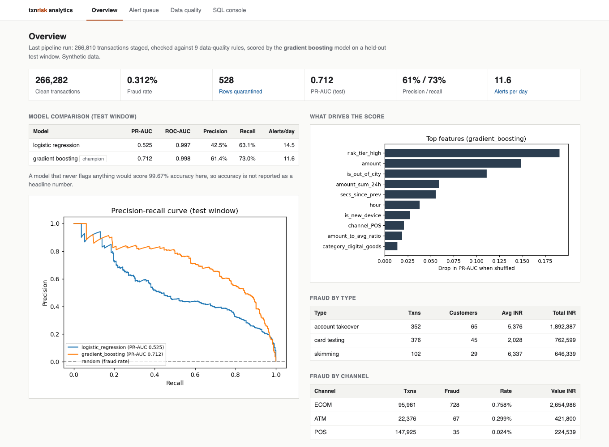
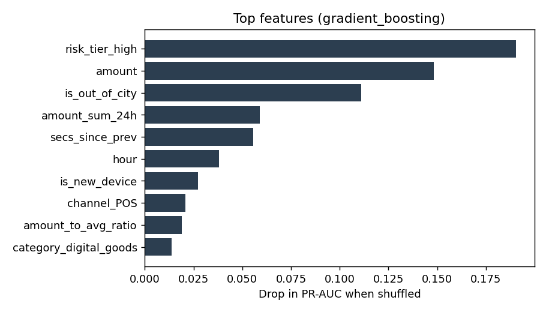
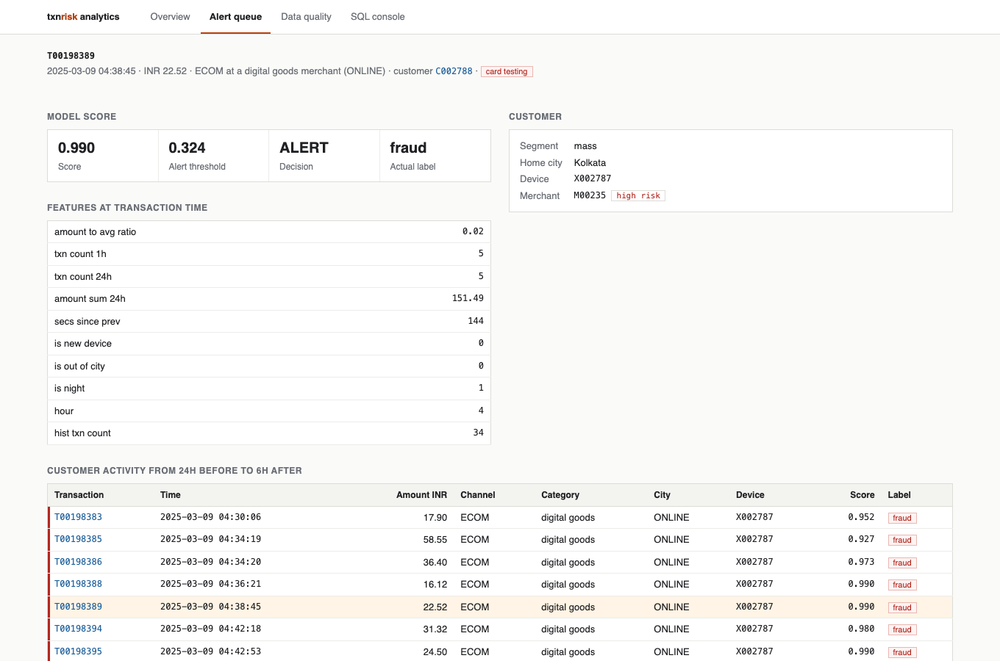
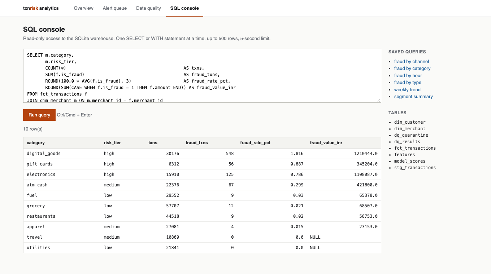
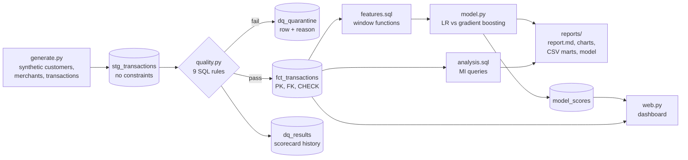

# Transaction Risk Analytics

An end-to-end card-transaction analytics pipeline: **SQL data warehouse → rule-based data-quality checks → SQL feature engineering → fraud model → MI report, Power BI marts and a web dashboard.**

It runs on ~267,000 synthetic transactions in under 30 seconds on a laptop, and every number in this README comes from [`reports/report.md`](reports/report.md), which the pipeline regenerates on each run.



## Why this project

Most fraud-detection notebooks start from a clean Kaggle CSV and report accuracy. Real bank data does neither. It arrives with duplicates, nulls and orphaned keys, and fraud is so rare (~0.3% here) that a model that never flags anything is already 99.7% "accurate". This project tackles both problems:

| Problem in real data | What this pipeline does |
| --- | --- |
| Dirty source feeds | Lands raw data in an unconstrained staging table, scores it against 9 data-quality rules across 5 dimensions, quarantines failing rows with a reason, and promotes only clean rows to a constrained fact table |
| "Did we lose anything?" | Row-count **and** amount control-total reconciliation: `staged = promoted + quarantined`, or the run fails |
| Fraud is rare | Evaluated with PR-AUC, precision, recall and alerts per day, not accuracy |
| Future data leaking into training | Time-based split (train on Jan–Feb, test on March); the alert threshold is tuned on a separate validation window |
| Features that don't exist at decision time | Every behavioural feature is a backward-looking SQL window function |

## Results (default run, seed 42)

**Data quality:** the generator deliberately injects 6 defect types (88 rows each). The rule engine caught **all 528 bad rows**, quarantined them and reconciled to the rupee.

| Rule | Dimension | Failed rows | Status |
| --- | --- | --- | --- |
| txn_id_unique | uniqueness | 88 | FAIL (threshold 100%) |
| amount_not_null | completeness | 88 | PASS (threshold 99.9%) |
| amount_positive | validity | 88 | PASS |
| channel_in_domain | validity | 88 | PASS |
| ts_not_in_future | timeliness | 88 | PASS |
| merchant_exists | referential integrity | 88 | FAIL (threshold 100%) |

**Fraud model:** evaluated on the held-out March test window (74,281 transactions, 244 fraud):

| Model | PR-AUC | ROC-AUC | Precision | Recall | F1 | Alerts/day |
| --- | --- | --- | --- | --- | --- | --- |
| Logistic regression (baseline) | 0.525 | 0.997 | 42.5% | 63.1% | 0.508 | 14.5 |
| **Gradient boosting (champion)** | **0.712** | **0.998** | **61.4%** | **73.0%** | **0.667** | **11.6** |

The champion catches 73% of fraud transactions while raising about 12 alerts a day for a review team. Note that ROC-AUC is ~0.998 for *both* models and barely separates them on imbalanced data. PR-AUC shows the real gap.



The strongest signals are merchant risk tier, amount, out-of-city physical spend (skimming), 24-hour spend velocity and time since the previous transaction (card testing).

## Dashboard

```bash
python -m txnrisk serve      # http://localhost:5003 (runs the pipeline first if there is no warehouse yet)
```

- **Overview:** headline numbers, model comparison, PR curve, feature importance, fraud by type and channel
- **Alert queue:** every transaction the model alerted on in the test window, split into *confirmed fraud*, *false alarms* and *missed fraud*, so the trade-off behind the threshold is visible
- **Transaction drill-down:** score vs threshold, the features the model saw, and the customer's activity from 24 hours before to 6 hours after. A card-testing burst or an account-takeover spree is obvious at a glance
- **Data quality:** the rule scorecard with each rule's SQL predicate, reconciliation status, and the actual quarantined rows for any rule
- **SQL console:** read-only queries against the warehouse, with the MI queries from `analysis.sql` preloaded. It uses a read-only connection plus an SQLite authorizer that denies anything except reads, one statement per run, a 500-row cap and a 5-second limit





## Architecture



## Quick start

```bash
python -m venv .venv && source .venv/bin/activate    # Windows: .venv\Scripts\activate
pip install -r requirements.txt

python -m txnrisk                                     # full run, writes reports/ and data/warehouse.db
python -m txnrisk --customers 20000 --days 120        # bigger dataset
python -m txnrisk serve                               # dashboard on http://localhost:5003
pytest -q                                             # 8 tests
```

Options: `--customers`, `--merchants`, `--days`, `--fraud-rate`, `--seed`, `--db`, `--out`.

Explore the warehouse directly:

```bash
sqlite3 data/warehouse.db "SELECT rule, COUNT(*) FROM dq_quarantine GROUP BY rule;"
```

## Project structure

```
txn-risk-analytics/
├── txnrisk/
│   ├── generate.py     # synthetic data: spending behaviour, 3 fraud scenarios, realistic noise, injected defects
│   ├── warehouse.py    # SQLite connection, schema, loads, named-query runner
│   ├── quality.py      # DQ rules, scorecard, quarantine, reconciliation
│   ├── model.py        # time split, LR vs HistGradientBoosting, threshold tuning, permutation importance
│   ├── report.py       # Markdown report, charts, CSV marts
│   ├── pipeline.py     # CLI orchestration
│   ├── web.py          # Flask dashboard + read-only SQL console
│   └── templates/, static/
├── sql/
│   ├── schema.sql      # star schema: dim_customer, dim_merchant, stg/fct_transactions, dq tables
│   ├── features.sql    # velocity, spend and device features via window functions
│   └── analysis.sql    # MI queries: fraud by channel, category, hour, type, week, segment
├── tests/              # generator, DQ detection, reconciliation, feature windows, split, SQL console guard
├── docs/               # screenshots
└── reports/            # output of the last run (committed so results are visible on GitHub)
```

## How the synthetic data works

The generator models how people actually spend, then adds three fraud patterns:

- **Account takeover:** a burst of 3–8 high-value online purchases at high-risk merchants within two hours, often at night. 35% of these come from the victim's *own* device (malware or session hijack), so "new device" is not a giveaway.
- **Card testing:** 4–10 tiny digital-goods charges within 20 minutes, then 1–2 large electronics purchases.
- **Skimming:** a cloned card used in person (ATMs, shops) in a different city.

To keep the problem honest, it also adds legitimate behaviour that *looks* risky: customers who travel, night-owl customers, online shopping sprees and new phones. 8% of fraud is never reported (label noise), as happens with real chargebacks.

## Using the output in Power BI / Excel

`reports/marts/` holds tidy CSVs (`fraud_by_channel`, `fraud_by_category`, `fraud_by_hour`, `fraud_by_type`, `weekly_trend`, `segment_summary`, `dq_scorecard`, `model_comparison`). Load them with *Get Data → Text/CSV* to build a dashboard, or connect Power BI straight to `data/warehouse.db` through an SQLite ODBC driver.

## Limitations and next steps

- The data is synthetic. The patterns are realistic but simpler than production fraud.
- Labels are known immediately. In practice chargebacks arrive weeks later, so the training window would need a label-maturity lag.
- Next steps: probability calibration, cost-based thresholds (fraud loss vs. analyst time) and drift monitoring between scoring windows.

> **Note for macOS:** with NumPy 2 on Apple Silicon you may see `RuntimeWarning: overflow encountered in matmul` from scikit-learn. This is a known spurious warning from Apple's Accelerate BLAS and does not affect results.
