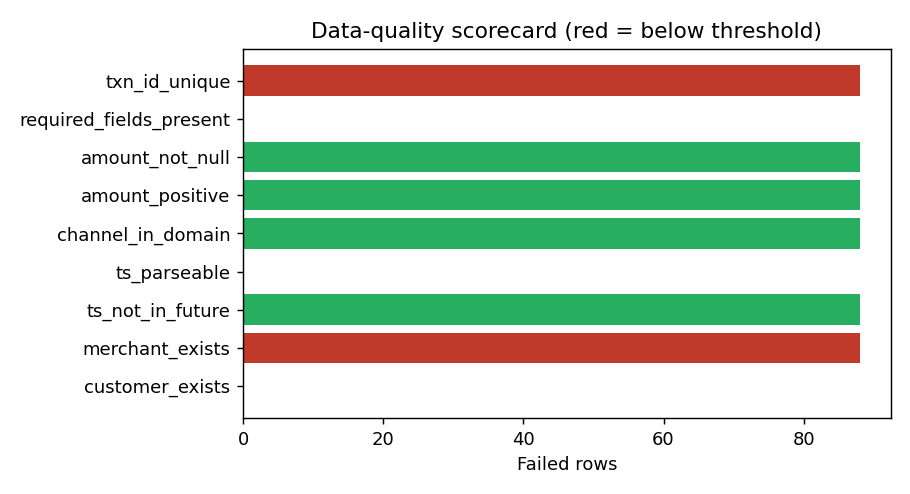
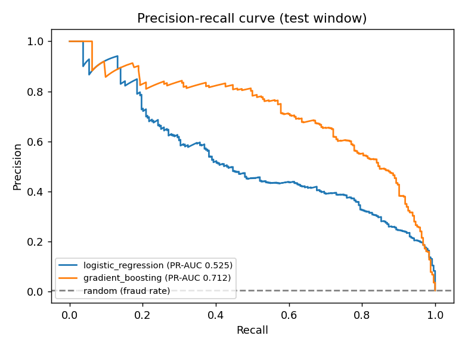
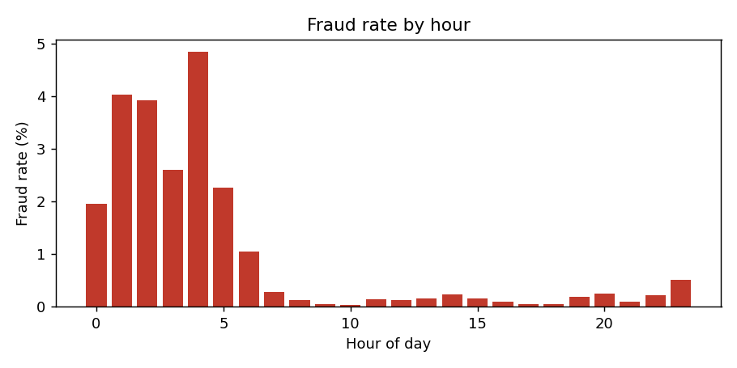

# Transaction Risk Analytics - Run Report

_Generated by `python -m txnrisk`. All data is synthetic._

## 1. Data volumes

| customers | merchants | staged_txns | clean_txns | fraud_txns | fraud_rate_pct |
| --- | --- | --- | --- | --- | --- |
| 5,000 | 800 | 266,810 | 266,282 | 830 | 0.3120 |

## 2. Data quality

Defects injected by the generator (ground truth):

| defect_type | injected_rows |
| --- | --- |
| null_amount | 88 |
| negative_amount | 88 |
| future_timestamp | 88 |
| orphan_merchant | 88 |
| invalid_channel | 88 |
| duplicate_row | 88 |

Scorecard from the rule engine:

| rule | dimension | failed_rows | pass_rate | threshold | status |
| --- | --- | --- | --- | --- | --- |
| txn_id_unique | uniqueness | 88 | 0.999670 | 1.000000 | FAIL |
| required_fields_present | completeness | 0 | 1.000000 | 0.999000 | PASS |
| amount_not_null | completeness | 88 | 0.999670 | 0.999000 | PASS |
| amount_positive | validity | 88 | 0.999670 | 0.999000 | PASS |
| channel_in_domain | validity | 88 | 0.999670 | 0.999000 | PASS |
| ts_parseable | validity | 0 | 1.000000 | 0.999000 | PASS |
| ts_not_in_future | timeliness | 88 | 0.999670 | 0.999000 | PASS |
| merchant_exists | referential_integrity | 88 | 0.999670 | 1.000000 | FAIL |
| customer_exists | referential_integrity | 0 | 1.000000 | 1.000000 | PASS |

Reconciliation (staged = promoted + quarantined):

| staged_rows | promoted_rows | quarantined_rows | rows_balanced | staged_amount | promoted_amount | quarantined_amount | amount_balanced |
| --- | --- | --- | --- | --- | --- | --- | --- |
| 266,810 | 266,282 | 528 | 1 | 798,585,511 | 798,012,845 | 572,666 | 1 |

## 3. Fraud model

Time-based split - train 121,287 rows (452 fraud), validation 29,503 (134 fraud), test 74,281 (244 fraud), test period 2025-03-07 to 2025-03-31.

| model | PR-AUC | ROC-AUC | precision | recall | F1 | alerts/day | fraud value caught % |
| --- | --- | --- | --- | --- | --- | --- | --- |
| logistic_regression | 0.5250 | 0.9966 | 0.4254 | 0.6311 | 0.5083 | 14.4800 | 60.2059 |
| gradient_boosting | 0.7115 | 0.9978 | 0.6138 | 0.7295 | 0.6667 | 11.6000 | 62.6594 |

**Champion: `gradient_boosting`** at alert threshold 0.324 (tuned on validation): precision 61.4%, recall 73.0%, 62.7% of fraud value caught, 11.6 alerts/day.

Confusion matrix on test: TP 178, FP 112, FN 66, TN 73,925.

Why not accuracy? A model that flags nothing scores **99.67%** accuracy on the test window while catching zero fraud. The champion's accuracy is 99.76% - almost the same number, which is exactly why it is the wrong metric here.

## 4. Business MI

### fraud_by_channel

| channel | txns | fraud_txns | fraud_rate_pct | fraud_value_inr |
| --- | --- | --- | --- | --- |
| ECOM | 95,981 | 728 | 0.758 | 2,654,986 |
| ATM | 22,376 | 67 | 0.299 | 421,800 |
| POS | 147,925 | 35 | 0.024 | 224,539 |

### fraud_by_category

| category | risk_tier | txns | fraud_txns | fraud_rate_pct | fraud_value_inr |
| --- | --- | --- | --- | --- | --- |
| digital_goods | high | 30,176 | 548 | 1.816 | 1,210,444 |
| gift_cards | high | 6,312 | 56 | 0.887 | 345,204 |
| electronics | high | 15,910 | 125 | 0.786 | 1,108,087 |
| atm_cash | medium | 22,376 | 67 | 0.299 | 421,800 |
| fuel | low | 29,552 | 9 | 0.030 | 65,378 |
| grocery | low | 57,707 | 12 | 0.021 | 68,507 |
| restaurants | low | 44,518 | 9 | 0.020 | 58,753 |
| apparel | medium | 27,081 | 4 | 0.015 | 23,153 |
| travel | medium | 10,809 | 0 | 0.000 | nan |
| utilities | low | 21,841 | 0 | 0.000 | nan |

### fraud_by_hour

### fraud_by_type

| fraud_type | fraud_txns | customers_hit | avg_amount_inr | total_value_inr |
| --- | --- | --- | --- | --- |
| account_takeover | 352 | 65 | 5,376 | 1,892,387 |
| card_testing | 376 | 45 | 2,028 | 762,599 |
| skimming | 102 | 29 | 6,337 | 646,339 |

### weekly_trend

| week | txns | spend_inr | fraud_txns | fraud_value_inr |
| --- | --- | --- | --- | --- |
| 2025-W00 | 14,689 | 43,838,827 | 0 | 0.000 |
| 2025-W01 | 20,662 | 61,700,863 | 0 | 0.000 |
| 2025-W02 | 20,759 | 61,056,854 | 80 | 312,196 |
| 2025-W03 | 20,637 | 61,549,417 | 84 | 303,979 |
| 2025-W04 | 20,731 | 63,564,550 | 14 | 61,195 |
| 2025-W05 | 20,749 | 61,724,265 | 59 | 229,719 |
| 2025-W06 | 20,569 | 62,306,759 | 90 | 347,479 |
| 2025-W07 | 20,671 | 61,331,326 | 111 | 455,556 |
| 2025-W08 | 20,753 | 60,738,256 | 102 | 363,716 |
| 2025-W09 | 20,691 | 62,876,985 | 88 | 391,534 |
| 2025-W10 | 20,736 | 64,055,389 | 48 | 216,062 |
| 2025-W11 | 20,924 | 62,913,932 | 77 | 354,340 |
| 2025-W12 | 20,812 | 61,691,969 | 77 | 265,549 |
| 2025-W13 | 2,899 | 8,663,453 | 0 | 0.000 |

### segment_summary

| segment | customers | txns | avg_ticket_inr | fraud_rate_pct |
| --- | --- | --- | --- | --- |
| premium | 462 | 35,264 | 5,067 | 0.147 |
| affluent | 1,492 | 87,401 | 3,260 | 0.288 |
| mass | 3,046 | 143,617 | 2,328 | 0.366 |
